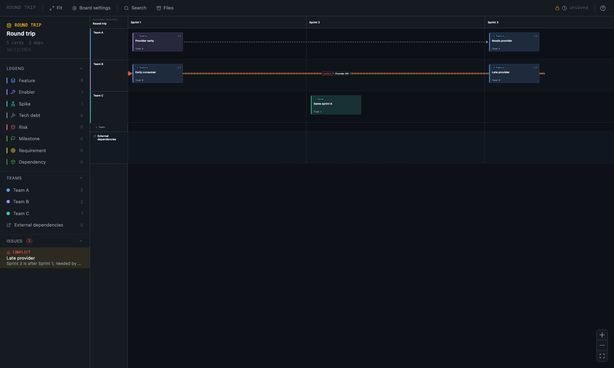

# PI Board

> **AI Declaration**: This project is an agentic coding experiment. The architecture, specification and code are generated with AI assistance (Claude, Anthropic). It is exploratory by nature: expect rough edges and the occasional questionable decision made at speed.

---

A privacy-first, offline dependency board for PI planning. Teams run down the side, sprints run across the top, and cards sit in the cells, like the wall at a PI planning event. A separate row holds external dependencies. Arrows show who needs what from whom, and the board flags any dependency that cannot work on the schedule as drawn.

Everything lives in a single `.piboard` file on your disk. No server, no cloud, no telemetry.



---

## Features

- **Swimlane matrix**: rows are teams, columns are sprints, plus an external-dependencies row that shares the sprint columns
- **Start and end of sprint**: each sprint is split into two sub-columns by a barely-there divider, so you can place a card early or late in a sprint
- **Typed, colour-coded cards**: Feature, Enabler, Spike, Tech debt, Risk, Milestone, Requirement and Dependency. Types are always shown as icon plus label, never colour alone. Add, recolour and reorder types per board
- **Requirements and dependencies**: a Requirement is something a team needs; a Dependency is something someone provides to meet it
- **A team owner** on every card
- **Straight dependency arrows**, joined bottom to top, with three states (proposed, agreed, at-risk) and a schedule check: a thick red dashed line means the provider is scheduled after the card waiting on it. Same-sprint, same-slot dependencies are tagged, and cycles are listed. Nothing is ever blocked, only shown
- **Focus mode**: select a card to light up everything upstream and downstream of it
- **Legend, team filters and an issues list** in the sidebar
- **Search** with `/` or `Ctrl+K`, across titles, owners, tags, descriptions and, optionally, long-form documents
- **Long-form card detail** in a BlockNote editor, loaded only when opened
- **Optional AES-256-GCM encryption** with a passphrase
- **Auto-save**, debounced, which never fires on pan or zoom
- **draw.io export**: Export in the toolbar writes a `.drawio` file with the same lanes, columns, card positions, sizes and colours as the board, plus a simpler Mermaid flowchart
- **Dark and light themes** and a text size control (85% to 200%) for cards and the row and column headers, saved per browser. The rest of the interface keeps its size. Cards keep a minimum size and grow to show their whole title when the text no longer fits
- **Hide the sidebar** (`[`) or take the **canvas full screen** (`F`, `Esc` to leave)
- **Offline first**: zero network requests at runtime

---

## The `.piboard` format

A `.piboard` file is a ZIP archive, optionally wrapped in an AES-GCM envelope (magic header `PB01`).

```
manifest.json   format id, schema version, title, timestamps
board.json      PI details, teams, sprints, card types, external lane label
cards.json      cards and dependencies
view.json       viewport only
assets/         attachments
content/        one BlockNote document per card with long-form detail
```

Pixel positions are never stored. They are derived from each card's team, sprint, slot and order on every render.

---

## Getting started

```bash
pnpm install
pnpm dev        # http://localhost:5173
pnpm test       # layout and dependency logic
pnpm lint
pnpm build      # static bundle in dist/
```

The built bundle is fully static and can be served from a USB stick or any local file server. Opening and saving files uses the File System Access API (Chromium browsers), with a file-input and download fallback elsewhere.

---

## Using the board

| Action | How |
| --- | --- |
| Add a card | Double-click an empty cell (the click position picks the start or end half of the sprint) |
| Move a card | Drag it to another cell or slot; drop between cards to insert |
| Link cards | Drag from a card's right dot to the left dot of the card that needs it |
| Focus a chain | Click a card |
| Rename a team or sprint | Double-click its header |
| Teams, sprints, types | Board settings |
| Delete | Select and press `Del` |
